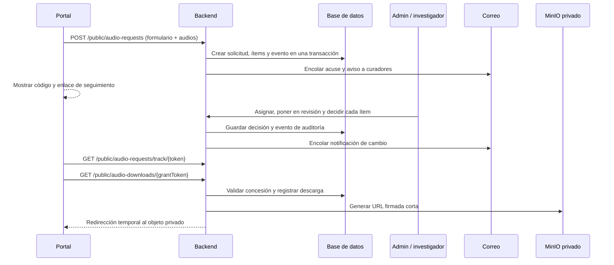

# Plan de reestructuración: solicitudes de audio

## Diagnóstico confirmado

El portal intenta usar `POST /audio-requests` y `POST /audio-request-items`. Ambos son CRUD administrativos: requieren JWT y el permiso `data.write`. Un visitante del portal no tiene esos permisos, por lo que la creación falla con `401 Bearer token required` (o `403` si porta un token sin permiso).

También hay problemas estructurales:

- La solicitud y cada ítem se crean en llamadas separadas; puede quedar una solicitud sin audios si una llamada falla.
- El portal llama directamente a una ruta del admin para enviar correo. Esa ruta permite CORS para cualquier origen y no debe ser el mecanismo de notificación.
- El estado existe solo a nivel de solicitud (`pending`, `approved`, `rejected`). No permite aprobar, denegar o dejar en espera un audio individual.
- Las pantallas admin usan el CRUD genérico. No existe asignación a investigador, historial de decisiones, control de concurrencia, ni entrega segura verificable.
- Si el archivo original de audio tiene una URL pública permanente, una aprobación no puede controlar la descarga. Para que la solicitud tenga sentido, el original solicitado debe permanecer privado.

## Decisión de almacenamiento necesaria

Separar los activos por nivel de acceso:

| Activo | Acceso recomendado |
| --- | --- |
| Miniaturas, imágenes públicas y vista previa corta de audio | URL pública permanente de MinIO |
| Audio original solicitado (WAV/FLAC u otra fuente) | Objeto privado de MinIO |
| Archivo concedido | URL firmada de corta duración emitida después de validar la autorización |

No se debe entregar la URL firmada dentro del correo. El correo enlaza al seguimiento; al pulsar descargar, el backend valida el permiso, registra la descarga y redirige a una URL firmada de MinIO.

## Flujo propuesto

## Modelo de datos

Crear una migración en `fonoteca-backend` y reemplazar progresivamente el uso CRUD genérico.

1. `audio_requests`
   - Mantener solicitante, institución y propósito.
   - Agregar `tracking_token_hash`, `status`, `assigned_to_user_id`, `submitted_at`, `review_started_at`, `resolved_at`, `terms_version`, `consent_at`, `last_notified_at`.
   - Estados: `submitted`, `in_review`, `partially_resolved`, `approved`, `denied`, `fulfilled`, `cancelled`, `expired`.

2. `audio_request_items`
   - Sustituir la clave compuesta por un `id` UUID.
   - Agregar `status`, `assigned_to_user_id`, `decision_reason_code`, `decision_note`, `decided_by_user_id`, `decided_at`, `hold_until`, `delivered_at`.
   - Estados: `pending`, `in_review`, `approved`, `denied`, `on_hold`, `unavailable`, `delivered`, `expired`.

3. `audio_request_events`
   - `id`, `request_id`, `request_item_id` opcional, actor, tipo de evento, detalle JSON y fecha.
   - Es la línea de tiempo visible en admin y, filtrada, en el seguimiento público.

4. `audio_download_grants`
   - `id`, `request_item_id`, `token_hash`, `expires_at`, `max_downloads`, `download_count`, `revoked_at`, `created_by_user_id`.
   - Nunca almacenar el token en claro; se entrega una sola vez en el enlace.

5. `notification_outbox`
   - Mensaje, destinatario, plantilla, estado, intentos y próximo reintento.
   - Se escribe dentro de la misma transacción que la decisión y un trabajador lo envía con reintentos.

## API backend

No exponer el CRUD administrativo para el portal.

- `POST /public/audio-requests`: público, valida formulario, captcha/Turnstile, límite por IP y correo, audios publicados y elegibles; crea solicitud + ítems + evento en una transacción. Devuelve código y token de seguimiento.
- `GET /public/audio-requests/track/:token`: público por token de alta entropía; devuelve solo la solicitud propia, estado e ítems sin URLs privadas.
- `POST /public/audio-requests/track/:token/resend`: reenvía el enlace con límite estricto.
- `GET /public/audio-downloads/:grantToken`: valida concesión, expiración y cuota; registra la descarga y emite/redirige a una URL firmada de MinIO.
- `GET /audio-requests`, `GET /audio-requests/:id`: solo personal autorizado, con ítems y eventos.
- `PATCH /audio-requests/:id/assign`, `PATCH /audio-requests/:id/status`: asignación y cambios válidos de solicitud.
- `PATCH /audio-request-items/:id/decision`: aprobar, denegar, poner en espera o marcar no disponible, con motivo obligatorio cuando corresponda.
- `POST /audio-request-items/:id/grants`: crea o revoca la concesión de descarga.

Cada operación de staff debe verificar permisos específicos, por ejemplo `audio_requests.review` y `audio_requests.assign`; no basta `data.write`.

## Portal

1. Conservar el carrito, pero enviar todos los ítems en una sola llamada al endpoint público.
2. Formulario: nombre, correo, institución, categoría de uso separada, propósito, versión de términos y consentimiento.
3. Antes de enviar: evitar duplicados, mostrar número de audios y validar que sigan disponibles.
4. Al terminar: mostrar código de seguimiento y explicar que llegará un correo; no prometer aprobación ni una URL de descarga inmediata.
5. Crear `/es/solicitudes/:token` con progreso de la solicitud e ítems: recibido, en revisión, aprobado, denegado, en espera o entregado.
6. En estados parciales, el usuario ve exactamente qué audios fueron aprobados o no, y puede descargar únicamente los concedidos.

## Admin

1. Bandeja con filtros por estado, investigador asignado, antigüedad y solicitudes vencidas.
2. Al abrir una solicitud: datos del solicitante, propósito, lista de ítems, previsualización autorizada, historial y notas internas.
3. Asignar un responsable; al tomar un ítem se registra `in_review`. Si otro investigador ya trabaja en él, mostrar responsable y fecha, sin bloquear la visibilidad.
4. Acciones por ítem: aprobar, denegar, poner en espera, no disponible; exigir motivo en denegación/espera.
5. Acciones masivas solo como atajo: cada ítem conserva su propia decisión y evento.
6. Antes de enviar, presentar un resumen de correo con las decisiones. La aprobación crea concesiones de descarga, no publica el archivo original.

## Correos y trazabilidad

- Acuse al solicitante al registrar la solicitud, con enlace seguro de seguimiento.
- Aviso a la cola de curadores, no a una ruta HTTP pública del admin.
- Notificación al solicitante cuando cambia el estado o se resuelve un ítem.
- Recordatorio de solicitudes en espera y alertas de concesiones próximas a vencer.
- Enviar mediante `MailService` del backend y `notification_outbox`; el admin no debe ser el emisor de eventos de negocio.

## Seguridad y operación

- Usar tokens aleatorios de alta entropía, almacenar solamente su hash y aplicar límites de tasa por IP/correo.
- Añadir captcha/Turnstile y campo honeypot al formulario público.
- Validar que los `multimedia_id` sean audios públicos solicitables antes de crear ítems.
- Mantener los originales de audio privados en MinIO; la URL pública permanente solo corresponde a previews autorizados.
- Auditar creación, asignación, cambios de estado, emisión/revocación de concesiones y descargas.
- Definir retención de PII y un mecanismo de cancelación de solicitud.

## Implementación por fases

1. **Corregir el bloqueo actual.** Crear el endpoint público transaccional en backend; cambiar portal a una sola llamada; retirar la llamada del portal a `/api/audio-requests/created` del admin.
2. **Base de workflow.** Migración, servicios de dominio, endpoints de staff, autorización y línea de tiempo.
3. **Experiencia de portal y admin.** Seguimiento con token, bandeja, decisiones por ítem, asignación y estados de espera.
4. **Entrega protegida.** Concesiones, descarga registrada y MinIO privado para originales; previews públicos separados.
5. **Notificaciones confiables.** Outbox, plantillas backend, reintentos y panel de fallos de correo.
6. **Calidad y despliegue.** Pruebas de transacción, permisos, expiración, concurrencia, reintentos de correo y migración de solicitudes antiguas.

## Criterios de aceptación

- Un visitante puede crear una solicitud sin JWT y recibe un código de seguimiento.
- No existe una solicitud incompleta si falla la creación de un ítem.
- Un administrador puede resolver una parte del conjunto y dejar otra parte en espera.
- El solicitante solo ve su información mediante su token y nunca recibe URLs privadas en la respuesta de seguimiento.
- Cada descarga aprobada queda registrada y deja de funcionar al vencer o revocarse.
- Un fallo de correo no pierde la solicitud ni la decisión; se reintenta desde la cola.
